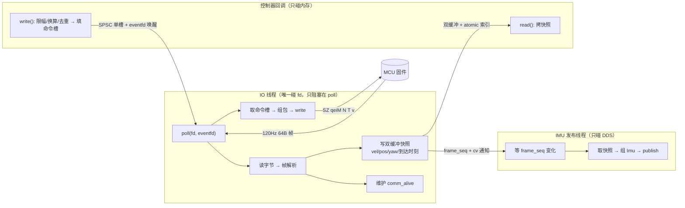
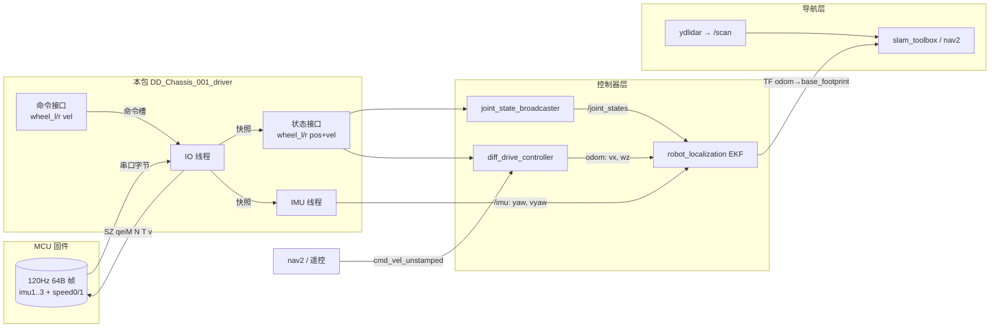
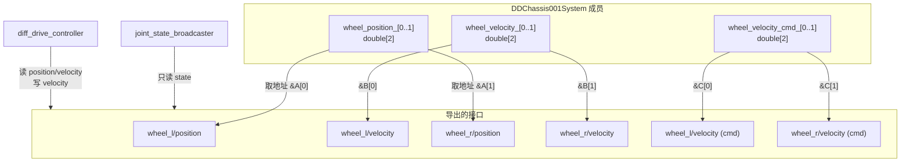

# 设计说明：到底要做成什么东西

本文档回答一个问题：**为了让 `diff_drive_controller` 能驱动真车、让 nav2 能用上真车，我需要写出哪些东西、它们各自长什么样、彼此怎么连。**

---

## 1. 一句话结论

你要做的是一个**被 `controller_manager` 动态加载的 C++ 共享库**（`libDD_Chassis_001_driver.so`），它实现了 `hardware_interface::SystemInterface`，职责只有两条：

- 每个控制周期**读**：从串口拿到两轮实测转速 + IMU 欧拉角，填进状态变量；
- 每个控制周期**写**：把控制器算出的两轮目标角速度换算成固件命令，写进串口。

就这两条。差速运动学、里程计、限速、导航全都不归你管——那是控制器和 nav2 的事。

---

## 2. 总体架构：三线程 + 三个内存数据面

### 2.1 铁律

1. **串口只能有一个所有者**：轮速与 IMU 同帧上报、且固件随时接收指令 → 不能拆成多个硬件组件抢同一个 fd。
2. **ROS 回调里不碰串口**：`read()`/`write()` 只做内存读写，任何 syscall 都不进回调。
3. **DDS 不阻塞 IO**：`publish()` 可能阻塞毫秒级，绝不能与串口读取共享线程。
4. **安全命令优先**：停机命令（0 速度）必须能插队，不能被"去重/等待"吞掉。

### 2.2 线程分工



| 线程 | 碰 fd | 允许阻塞 | 触发方式 | 职责 |
| --- | --- | --- | --- | --- |
| IO | **是（独占）** | 仅 `poll` | 串口数据 / 命令唤醒 | 读帧、解析、积分位置、写命令、判定超时 |
| IMU 发布 | 否 | 仅 DDS（只拖自己） | `frame_seq` 变化 | 取快照 → `sensor_msgs/Imu` → publish |
| 控制器回调 | 否 | 不阻塞 | controller_manager 定时 | `read()` 拷快照、`write()` 填命令槽 |

### 2.3 三个数据面

| 数据面 | 生产者 | 消费者 | 实现 | 说明 |
| --- | --- | --- | --- | --- |
| 状态快照 | IO 线程 | `read()` / IMU 线程 | 双缓冲 + `atomic<uint32_t>` 索引 | 消费者只拷贝，不加锁 |
| 命令槽 | `write()` | IO 线程 | SPSC 单槽（覆盖式）+ `atomic` + `eventfd` | 只保留最新目标值，不排队 |
| 新帧事件 | IO 线程 | IMU 线程 | `frame_seq` + `condition_variable` | 事件驱动，不重复发旧帧 |

### 2.4 为什么必须有 eventfd

IO 线程平时阻塞在 `poll()` 等串口数据（约 8ms 一帧）。若 `write()` 填了命令槽却不唤醒它，指令要等到下一帧上报才发出，表现为"`cmd_vel` 发出后延迟最多 8ms"。`eventfd` 就是让命令延迟降到微秒级的唯一机制，`poll` 同时监听串口 fd 与 eventfd。

### 2.5 端到端数据流（谁产生、谁消费）



**关键认识**：`/imu` 由组件内部自建节点发布，**不经过** ros2_control 接口体系（Humble 无 `imu_sensor_broadcaster`）。

### 2.6 IMU 发布策略

- **事件驱动**：等 `frame_seq` 变化再发，不用定时器 → 不会重复发旧帧，固件掉帧时 IMU 同步少发（正确行为）。
- **降采样**：`imu_publish_rate` 仅作上限/抽帧系数（上报 120Hz、设 60 则每 2 帧发 1 次）。默认与上报同频。
- **时间戳取「帧到达时刻」**：IO 线程记 `steady_clock`，换算成 ROS time 后填 `header.stamp`。开机记一次 `ros_now - steady_now` 偏移，之后用 steady 推进、每隔约 10s 校正，避免 `now()` 进热路径。
- **QoS**：`BEST_EFFORT`，`depth=10`。不用 RELIABLE，避免某个慢订阅者顶死发布线程。
- **协方差**：只让 yaw 与 yaw 角速度可信，其余置大值（roll/pitch 与 x/y 角速度 = 1e6；`linear_acceleration_covariance[0] = -1` 表示不提供）。

### 2.7 线程与生命周期

| 回调 | 动作 |
| --- | --- |
| `on_init` | 解析参数、校验（不建线程、不开串口） |
| `on_configure` | 开串口、建 eventfd、**启动 IO 线程** |
| `on_activate` | **启动 IMU 线程**、状态清零 |
| `on_deactivate` | 填 0 速度命令并等待 IO 发出；停 IMU 线程 |
| `on_cleanup` | 置停止标志 → 唤醒 poll/cv → join → 关 fd |
| `on_shutdown` | 同上，且带超时；超时后允许**直接写一次 0 速度**（安全例外） |
| `on_error` | 尝试停机，不抛异常 |

退出顺序必须是：**先置标志 + 唤醒等待者，再 join**，否则线程会卡死在 `poll`/`cv.wait` 上无法退出。

## 3. 必须交付的清单

| 编号 | 交付物 | 必须做到 | 做不到的后果 |
| --- | --- | --- | --- |
| D1 | 共享库 `libDD_Chassis_001_driver.so` | 实现 `SystemInterface` 全部纯虚函数 | 类为抽象类，加载即崩 |
| D2 | pluginlib 描述 xml | `library path` = CMake 目标名；`class type` = 宏里的类型 | `controller_manager` 找不到插件 |
| D3 | `pluginlib_export_plugin_description_file()` | 在 CMake 里登记 | 同上 |
| D4 | 帧解析器 | 无帧头 → 靠帧尾魔数对齐；能承受丢字节 | 偶发乱跳、数据错位 |
| D5 | 命令组包 | `SZ qeiM <i> T <值>\n`（**前缀必须大写**） | 指令被固件静默丢弃 |
| D6 | 参数体系 | 全部走 URDF `<param>`；串口/帧尾/系数/方向/限幅/超时 | 改一次参数要重编 |
| D7 | `/imu` 发布 | 只给 yaw 可信度，其余协方差置大 | EKF 被假数据带偏 |
| D8 | 安全行为 | 断线/停用/退出时下发 0 速度 | 车失控 |

---

## 4. 接口契约（必须与 URDF 严格一致）

URDF 里写的 joint 名和接口名，决定了 `export_*` 里字符串怎么写，三处**必须完全一致**：

```xml
<!-- URDF -->
<joint name="wheel_l">
  <command_interface name="velocity"/>   <!-- → 你导出 wheel_l/velocity (command) -->
  <state_interface name="position"/>     <!-- → 你导出 wheel_l/position (state)   -->
  <state_interface name="velocity"/>     <!-- → 你导出 wheel_l/velocity (state)   -->
</joint>
```

```cpp
// export_state_interfaces()
state_interfaces.emplace_back("wheel_l", HW_IF_POSITION, &wheel_position_[0]);
                                       ^^^^^^^^^^^ 必须来自参数，不能硬编码
```

- `diff_drive_controller` 只用 **velocity 命令 + position/velocity 状态**，多做无用。
- 不要做 effort 接口（固件没有力矩环）。

---

### 4.1 类成员 ↔ 接口 ↔ 控制器（指针关系）



> 控制器通过指针直接读写这些 `double`，所以它们**必须常驻、地址不能变**（用固定大小数组，别用会重新分配的 `vector`）。

## 5. 你真正要写的三块逻辑

### 5.1 帧解析（最容易写错）
- 帧=15×float32 + 1×uint32 帧尾 = **64 字节**，小端。
- **没有帧头**，只能靠帧尾魔数找边界：缓冲区里搜到魔数，它前面 64 字节就是一帧。
- 三条铁律：
  1. 找不到魔数时，**保留末尾 63 字节**（不是 3 字节）——帧体可能还在路上；
  2. 魔数出现在不足 64 字节处 → 丢掉到该魔数之后并**继续扫**，不能 return；
  3. 一次 push 要**循环解析多帧**（120Hz 上报 > 控制周期）。

### 5.2 单位换算（决定车能不能按预期动）
定义唯一一处换算，两个方向都用它：

```
state: 关节角速度[rad/s] = 固件 speed 值 × speed_scale
cmd  : 固件值           = 关节角速度[rad/s] ÷ speed_scale
方向相反再套 invert（scale 恒为正，方向和比例分开，别再混）
```

标定方法：让固件以固定目标值转，量轮子实际 rad/s，`speed_scale = 实测rad/s ÷ 上报speed`。

### 5.3 安全与健壮性（在新架构下的落点）
- **超时**：由 **IO 线程**维护 `comm_alive`（它才知道多久没收到帧，精度是毫秒级，不受控制周期影响）。超时后 IO 线程自己下发 0；`read()` 只消费快照、上报 0，**不返回 ERROR**（返回 ERROR 会让控制器停机并可能留下最后速度值）。
- **停机**：`on_deactivate`/`on_shutdown`/`on_error` 都只能「填 0 命令 + 唤醒 IO 线程」，**不在回调里写串口**；`on_shutdown` 带超时，超时后允许直写一次（安全例外）。
- **安全命令插队**：0 速度不能被 `command_epsilon` 去重逻辑吞掉，命令槽需带 `priority` 标志。
- **限幅**：`max_wheel_velocity` 在 `write()` 里算（纯内存），防止上游发疯。
- **指令去重**：`write()` 里比较原值，变化超过 `command_epsilon` 才填槽；槽是覆盖式的，天然不做队列。
- **不阻塞**：`read()`/`write()` 内部禁止任何 syscall、锁等待、日志 IO（日志要限流且非阻塞）。

---

## 6. 参数清单（放 URDF `<hardware>` 里）

| 参数 | 作用 | 备注 |
| --- | --- | --- |
| `serial_device` | 串口设备 | 如 `/dev/ttyUSB1` |
| `baud_rate` | 波特率 | termios 映射表里没有的值会打不开 |
| `frame_end` | 帧尾魔数 | 对齐帧的唯一依据，必填 |
| `frame_timeout_ms` | 断线判定 | 建议 ≥ 5 个上报周期 |
| `left/right_wheel_joint` | 与 URDF joint 名对应 | |
| `left/right_motor_index` | 固件里的电机号 | 0/1，可能是反的 |
| `left/right_speed_scale` | 单位换算 | 标定得到 |
| `left/right_invert` | 方向取反 | 只表达方向，不改比例 |
| `max_wheel_velocity` | 角速度限幅 | rad/s，≤0 表示不限 |
| `command_epsilon` | 下发去重阈值 | 太小会刷串口 |
| `publish_imu`/`imu_topic`/`imu_frame_id` | IMU 发布 | |
| `imu_yaw_field` | 用 imu1/2/3 哪一路 | 1~3 |
| `imu_angle_is_deg` | 单位是度还是弧度 | |
| `imu_publish_rate` | IMU 抽帧上限 | 默认=上报频率；设 60 即每 2 帧发 1 次 |
| `imu_stamp_offset_calib_s` | 时间偏移校正周期 | 默认 10s |
| `command_repeat_period_ms` | 命令重发周期 | 0=仅变化时发 |
| `debug_log` | 打印帧/下发内容 | 上线前关掉（且日志不得进热路径） |

---

## 7. 验收标准（做完的定义）

1. `colcon test` 里 `load_plugin` 通过 → 插件能被加载。
2. `ros2 control list_hardware_components` → `state: active`。
3. `ros2 topic hz /joint_states` ≈ 你配的 `update_rate`。
4. 手转轮子，`/joint_states` 的 velocity 跟着变且**方向为正**（向前）。
5. 车体逆时针转，`/imu` 的 yaw **增大**。
6. 发 `/diff_drive_controller/cmd_vel_unstamped`（BEST_EFFORT）→ 轮子转动、`odom.twist.twist.linear.x` 跟上指令。
7. 拔掉串口 → 日志出现超时告警、上报归零、电机停。
8. 直线走 1m，`odom` 的 x 变化 ≈1m。
9. `ros2 topic hz /imu` ≈ 上报频率（或配置的抽帧值），且**长时间无累积漏发**。
10. 指令延迟：填槽到串口写出应 < 2ms（eventfd 生效）；拔掉串口后 IO 线程不卡死、`on_cleanup` 能 join 成功。

---

## 8. 已知的坑（都是实测踩过的）

| 坑 | 现象 | 处理 |
| --- | --- | --- |
| 命令前缀小写 `sz` | 串口有输出但 MCU 无反应 | 用 `SZ` |
| QoS 不匹配 | 有发布者、无报错、车不动 | 发布端 BEST_EFFORT，或加中继节点 |
| 波特率表不全 | `不支持的波特率: 1000000` | termios switch 补全 |
| `read/write` 返回类型写短了 | 「类仍是抽象类」 | 写全 `hardware_interface::return_type` |
| 接口数组用 vector 中途 resize | 指针失效、数据错乱 | 固定大小数组 |
| 帧缓冲只留 3 字节 | 掉帧、解析不出 | 留 63 字节 |
| 断线返回 ERROR | 控制器停机、遗留速度 | 上报 0 + 告警 |

---

## 9. 建议的编码顺序

每一步都有可验证的中间状态，不要跳步。

1. **接口骨架**：`on_init` 参数解析 + `export_*`。验证：控制器能起、`list_hardware_interfaces` 有 4+2 个接口，值恒 0。
2. **串口类**（纯 C++，无 ROS）：open/非阻塞 read/write + 波特率映射表。验证：独立小程序能读出原始字节。
3. **协议类**（纯 C++）：帧解析 + 命令组包。验证：喂假字节序列（逐字节、前置垃圾、丢字节、多帧连发）都能正确取帧。
4. **IO 线程**：`poll(fd, eventfd)` + 解析 + 双缓冲快照。验证：`debug_log` 打印帧率 ≈120Hz、手转轮子 speed 变化。
5. **`read()` 接快照**：验证 `/joint_states` 随手动轮变化，频率 = `update_rate`。
6. **命令槽 + `write()` + eventfd**：验证轮子能转，`debug_log` 能看到实际串口字符串 `"SZ qeiM 0 T xx\n"`。
7. **标定**：`speed_scale` + `invert`，验证方向与 1m 直线里程。
8. **IMU 线程**：`frame_seq` + cv + 时间戳偏移。验证 `hz /imu`、yaw 方向、EKF 正常。
9. **超时与生命周期**：`comm_alive`、停机优先、`on_cleanup` 能 join。验证拔串口场景。
